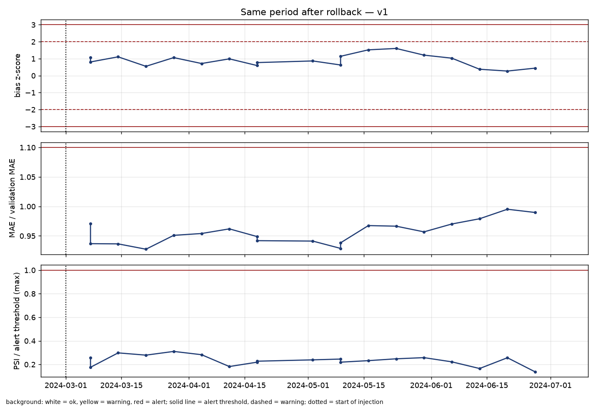

# Post-mortem: model retrained on a weather backfill in m/s

Simulated, replayable incident: `uv run python scripts/incident.py all` (isolated registry
`mlflow_incident.db`). Sources for all figures: `reports/incident/*.json` and
`reports/incident/timeline_*.csv`.

## 1. Summary

On March 1, 2024, a routine retraining runs on a weather backfill downloaded with
`wind_speed_unit=ms`: wind and gusts are divided by 3.6 over the whole history. The
challenger v2 wins the comparison and becomes champion. In production, the bias rises from the
first tournament. The trigger chooses the rollback on March 25, at the 4th tournament, before the
first alert (March 28). The PSI saw nothing; after the rollback, 19 checks out of 19 are ok.

## 2. Timeline

| Date (2024) | Event | Source |
|---|---|---|
| before | v1 in service (healthy champion, validation MAE 2.380) | `1_setup.json` |
| **March 1** | Retraining on the corrupted backfill. On the same 8 tournaments (2,959 player-rounds), v2 gets an MAE of 2.261 (bias +0.045) versus 2.316 (bias −0.285) for v1: **v2 is promoted** | `2_corrupt.json` |
| **March 7** | 1st tournaments served by v2. Arnold Palmer: ok (bias +0.44, z = 1.45). Puerto Rico Open: **warning** (bias +0.65, z = 2.15) | `timeline_detection.csv` |
| March 14 | THE PLAYERS: warning (bias +0.90, z = 2.97) | same |
| March 21 | Valspar: warning (bias +0.88, z = 2.90, MAE × 1.08) | same |
| **March 25** | Monday after Valspar: 3 consecutive warnings, 24 days after v2 went live → **the trigger chooses the rollback** (v2 → v1), 4 tournaments after the corruption | `3_detect.json`, `4_rollback.json` |
| **March 28** | Houston Open: **1st alert** (bias +1.26, z = 4.19, MAE × 1.165). The rollback is already done | `timeline_detection.csv` |

## 3. Detection

*Checks after each tournament with v2 (scenario without rollback). Top, the bias z-score;
middle, the MAE relative to the validation MAE; bottom, the PSI relative to the alert threshold.
Dotted line: March 1.*

- **Signal that raised the alarm: the performance bias**, measured by the z-score of the mean
  per-tournament bias over the last 8 tournaments. It goes to warning from the 2nd check (March 7) and
  stays there. The trigger rule, "3 degraded checks right after a deployment",
  fires the rollback **after 4 tournaments**. The monitoring alert alone would have waited until
  March 28, i.e. the 5th check. The MAE, slower, only crosses its threshold (× 1.10) on
  March 28.
- **Why the PSI saw nothing**: **0 PSI alerts** out of 19 checks (`3_detect.json`). The
  PSI / alert threshold ratio never exceeds 0.31, and the wind PSI never exceeds 0.40 while
  its alert threshold is 1.566 (`calibration.json`). The PSI compares production inputs
  with the 2018-2022 reference. Yet both datasets are **healthy**: the
  corruption is not in the inputs, it is in the data the served model
  learned from. No input signal could see it as long as the reference is not
  the served model's training data.
- **Why the champion / challenger comparison saw nothing**: the decision window came
  from the same backfill. `HistGradientBoostingRegressor` splits each feature by quantiles, so it
  is insensitive to a division of the wind by 3.6 applied everywhere. On this window, v2
  behaves like a healthy retraining on more recent data, hence its win.
  In production, the wind arrives in km/h, i.e. about 3.6 times more than anything v2 has seen.

## 4. Impact

- Tournaments predicted by v2: those of March 7, 14 and 21. The window bias goes from
  **+0.44 to +0.90 strokes per player-round** (v2 overestimates the scores) and the MAE rises up to
  1.08 × the validation.
- Without rollback, the scenario shows where it was heading: 15 alerts out of 19 checks, and a
  window bias up to **+1.94 strokes** (`bias_window_max`, May checks) with an MAE at 1.28 ×
  the validation.
- Over the same period, v1 keeps a window bias of +0.48 strokes at most (`5_recover.json`).

## 5. Root cause

The weather forecast backfill was re-downloaded from Open-Meteo with
`wind_speed_unit=ms` instead of the default unit, km/h. `fc_wind_mean` and `fc_gust_max`
are therefore 3.6 times too small over the whole history. No unit or range check exists
at ingestion. The promotion comparison uses the same corrupted data, so it
could not act as a guardrail.

## 6. Response

- **Automatic rollback** on March 25 by `pga.trigger` (code 30): `champion` ← v1,
  `previous` ← v2. The `rolled_back_from` / `rollback_reason` tags are set on v1, and a trace
  run is created in `pga-operations` (`4_rollback.json`). With `--api-url`, the API reloads
  the model and the command checks `/health`.
- **No retraining**: retraining on the same data would reproduce the bug.
- **Post-rollback check**: we replay monitoring over the same period with v1.

*With v1: 19 checks ok out of 19, bias z-score at most 1.6 (warning threshold: 2), MAE
always below the validation MAE.*

## 7. What worked, what did not

| Worked | Did not work |
|---|---|
| The per-tournament bias, scaled by its noise (z-score), goes to warning from the 2nd affected tournament (March 7) | The PSI: 0 alerts, the reference does not describe the served model's training data |
| The rule "degradation right after a deployment → rollback" acts before the 1st alert | The champion / challenger comparison is fooled by a decision window taken from the same backfill |
| One-command rollback, symmetric, traced in MLflow; the API follows without restarting | Nothing blocked the backfill at ingestion: the error is only seen after 4 tournaments in production |
| Performance thresholds read from the champion: after the rollback, monitoring judges v1 with its own thresholds | |

## 8. Corrective actions

| # | Action | Status |
|---|---|---|
| 1 | **Unit check at ingestion** (`weather.py`): the returned unit (`hourly_units`) must be km/h, and the wind median must stay within `params.yaml → weather.wind_median_kmh` | done |
| 2 | **PSI reference = served model's training data**: each run registers `reference_profile.json`, read back by monitoring. Falls back to `monitor.reference_years` for older versions | done |
| 3 | **Promotion blocked** if the challenger's data departs from the champion's profile (`trigger.promotion_blocks`); the version stays `candidate` with the `blocked_reason` tag | done |
| 4 | **Trigger rule**: a PSI alert shortly after a deployment points to that deployment, hence rollback | done |
| 5 | **Validation outside the backfill**: champion and challenger are compared on the API journal as soon as it covers the decision window (`trigger.journal_window`), tag `decision_source` | done |

## 9. The same incident after the fixes

Replayable: `uv run python scripts/incident.py all --guards`, results in
`reports/incident_guarded/`. The original scenario remains replayable without this option, and its
results are unchanged.

| | Before the fixes | After the fixes |
|---|---|---|
| Backfill on March 1 | promoted (MAE 2.261 versus 2.316) | **refused**: wind median 3.0 km/h, wind PSI 5.20 > 1.57, gust PSI 6.05 > 3.26 |
| If forced anyway: PSI alerts | 0 out of 19 checks | **19 out of 19** |
| First alert | March 28 | **March 7**, from the first tournament |
| Rollback | March 25, after 4 tournaments | **March 11**, after the first tournament |

The comparison on the journal (action 5) is enough on its own to refuse this backfill, without the other
guardrails (`2_journal.json`). On the inputs seen in production, the challenger is worse:
MAE 2.652 versus 2.268, bias +1.65 versus +0.22, whereas it won on the corrupted window
(2.261 versus 2.316).

Non-regression: the 2023-2024 natural drift still gives 79 ok, 9 warning, 1 alert, and the
legitimate retraining of February 5, 2024 is still promoted (MAE 2.326 versus 2.362).
