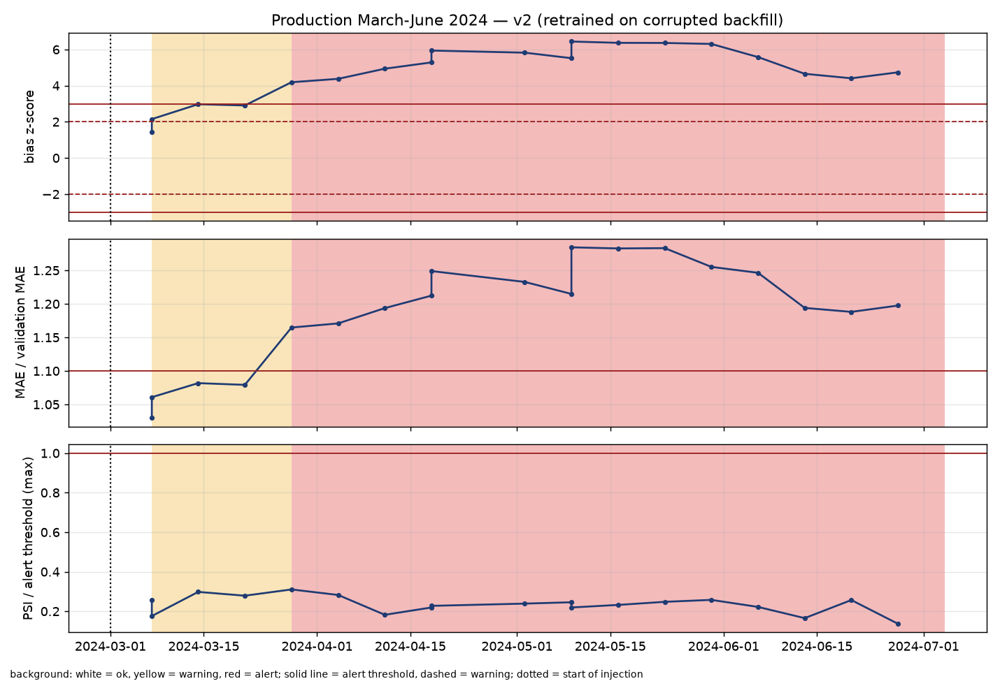

# Post-mortem : modèle réentraîné sur un backfill météo en m/s

Incident simulé, rejouable : `uv run python scripts/incident.py all` (registry isolé
`mlflow_incident.db`). Sources de tous les chiffres : `reports/incident/*.json` et
`reports/incident/timeline_*.csv`.

## 1. Résumé

Le 1er mars 2024, un réentraînement de routine se fait sur un backfill météo téléchargé avec
`wind_speed_unit=ms` : vent et rafales sont divisés par 3,6 sur tout l'historique. Le
challenger v2 gagne la comparaison et devient champion. En production, le biais monte dès le
premier tournoi. Le déclencheur choisit le rollback le 25 mars, au 4e tournoi, avant la
première alerte (28 mars). Le PSI n'a rien vu ; après le rollback, 19 contrôles sur 19 sont ok.

## 2. Chronologie

| Date (2024) | Événement | Source |
|---|---|---|
| avant | v1 en service (champion sain, MAE de validation 2,380) | `1_setup.json` |
| **1er mars** | Réentraînement sur le backfill corrompu. Sur les 8 mêmes tournois (2 959 joueur-tours), v2 obtient une MAE de 2,261 (biais +0,045) contre 2,316 (biais −0,285) pour v1 : **v2 est promue** | `2_corrupt.json` |
| **7 mars** | 1ers tournois servis par v2. Arnold Palmer : ok (biais +0,44, z = 1,45). Puerto Rico Open : **warning** (biais +0,65, z = 2,15) | `timeline_detection.csv` |
| 14 mars | THE PLAYERS : warning (biais +0,90, z = 2,97) | idem |
| 21 mars | Valspar : warning (biais +0,88, z = 2,90, MAE × 1,08) | idem |
| **25 mars** | Lundi après Valspar : 3 warnings consécutifs, 24 jours après la mise en service de v2 → **le déclencheur choisit le rollback** (v2 → v1), 4 tournois après la corruption | `3_detect.json`, `4_rollback.json` |
| **28 mars** | Houston Open : **1re alerte** (biais +1,26, z = 4,19, MAE × 1,165). Le rollback est déjà fait | `timeline_detection.csv` |

## 3. Détection

*Contrôles après chaque tournoi avec v2 (scénario sans rollback). En haut, le z-score du biais ;
au milieu, la MAE rapportée à la MAE de validation ; en bas, le PSI rapporté au seuil d'alerte.
Pointillé : 1er mars.*

- **Signal qui a alerté : le biais de performance**, mesuré par le z-score du biais moyen par
  tournoi sur les 8 derniers tournois. Il passe en warning dès le 2e contrôle (7 mars) et y
  reste. La règle du déclencheur, « 3 contrôles dégradés juste après une mise en service »,
  déclenche le rollback **au bout de 4 tournois**. L'alerte du monitoring seule aurait attendu
  le 28 mars, soit le 5e contrôle. La MAE, plus lente, ne dépasse son seuil (× 1,10) que le
  28 mars.
- **Pourquoi le PSI n'a rien vu** : **0 alerte PSI** sur 19 contrôles (`3_detect.json`). Le ratio
  PSI / seuil d'alerte ne dépasse jamais 0,31, et le PSI du vent ne dépasse jamais 0,40 alors
  que son seuil d'alerte est de 1,566 (`calibration.json`). Le PSI compare les entrées de
  production à la référence 2018-2022. Or ces deux jeux de données sont **sains** : la
  corruption n'est pas dans les entrées, elle est dans les données sur lesquelles le modèle
  servi a appris. Aucun signal d'entrée ne pouvait la voir tant que la référence n'est pas
  l'entraînement du modèle servi.
- **Pourquoi la comparaison champion / challenger n'a rien vu** : la fenêtre de décision venait
  du même backfill. `HistGradientBoostingRegressor` découpe chaque feature par quantiles, il
  est donc insensible à une division du vent par 3,6 appliquée partout. Sur cette fenêtre, v2
  se comporte comme un réentraînement sain sur des données plus récentes, d'où sa victoire.
  En production, le vent arrive en km/h, soit environ 3,6 fois plus que tout ce que v2 a vu.

## 4. Impact

- Tournois prédits par v2 : ceux des 7, 14 et 21 mars. Le biais de la fenêtre passe de
  **+0,44 à +0,90 coup par joueur-tour** (v2 surestime les scores) et la MAE monte jusqu'à
  1,08 × la validation.
- Sans rollback, le scénario montre où ça menait : 15 alertes sur 19 contrôles, et un biais de
  fenêtre jusqu'à **+1,94 coup** (`bias_window_max`, contrôles de mai) avec une MAE à 1,28 ×
  la validation.
- Sur la même période, v1 garde un biais de fenêtre de +0,48 coup au maximum (`5_recover.json`).

## 5. Cause racine

Le backfill de la météo prévue a été re-téléchargé depuis Open-Meteo avec
`wind_speed_unit=ms` au lieu de l'unité par défaut, le km/h. `fc_wind_mean` et `fc_gust_max`
sont donc 3,6 fois trop petits sur tout l'historique. Aucun contrôle d'unité ni de plage n'existe
à l'ingestion. La comparaison de promotion utilise les mêmes données corrompues, elle ne
pouvait donc pas servir de garde-fou.

## 6. Réaction

- **Rollback automatique** le 25 mars par `pga.trigger` (code 30) : `champion` ← v1,
  `previous` ← v2. Les tags `rolled_back_from` / `rollback_reason` sont posés sur v1, et un run
  de trace est créé dans `pga-operations` (`4_rollback.json`). Avec `--api-url`, l'API recharge
  le modèle et la commande vérifie `/health`.
- **Pas de réentraînement** : réentraîner sur les mêmes données reproduirait le bug.
- **Vérification après rollback** : on rejoue le monitoring sur la même période avec v1.

*Avec v1 : 19 contrôles ok sur 19, z-score du biais au plus 1,6 (seuil de warning : 2), MAE
toujours sous la MAE de validation.*

## 7. Ce qui a marché, ce qui n'a pas marché

| A marché | N'a pas marché |
|---|---|
| Le biais par tournoi, rapporté à son bruit (z-score), passe en warning dès le 2e tournoi touché (7 mars) | Le PSI : 0 alerte, la référence ne décrit pas les données d'entraînement du modèle servi |
| La règle « dégradation juste après une mise en service → rollback » agit avant la 1re alerte | La comparaison champion / challenger est trompée par une fenêtre de décision issue du même backfill |
| Rollback en une commande, symétrique, tracé dans MLflow ; l'API suit sans redémarrage | Rien n'a bloqué le backfill à l'ingestion : l'erreur n'est vue qu'après 4 tournois en production |
| Seuils de performance lus sur le champion : après le rollback, le monitoring juge v1 avec ses propres seuils | |

## 8. Actions correctives

| # | Action | État |
|---|---|---|
| 1 | **Contrôle d'unité à l'ingestion** (`weather.py`) : l'unité renvoyée (`hourly_units`) doit être km/h, et la médiane du vent rester dans `params.yaml → weather.wind_median_kmh` | fait |
| 2 | **Référence du PSI = données d'entraînement du modèle servi** : chaque run enregistre `reference_profile.json`, relu par le monitoring. Repli sur `monitor.reference_years` pour les versions plus anciennes | fait |
| 3 | **Promotion bloquée** si les données du challenger s'écartent du profil du champion (`trigger.promotion_blocks`) ; la version reste `candidate` avec le tag `blocked_reason` | fait |
| 4 | **Règle du déclencheur** : une alerte PSI peu après une mise en service désigne ce déploiement, donc rollback | fait |
| 5 | **Validation hors backfill** : décider la promotion sur les prédictions déjà journalisées, et non sur le backfill | à faire |

## 9. Le même incident après correctifs

Rejouable : `uv run python scripts/incident.py all --guards`, résultats dans
`reports/incident_guarded/`. Le scénario d'origine reste rejouable sans cette option, et ses
résultats sont inchangés.

| | Avant correctifs | Après correctifs |
|---|---|---|
| Backfill au 1er mars | promu (MAE 2,261 contre 2,316) | **refusé** : médiane du vent 3,0 km/h, PSI vent 5,20 > 1,57, PSI rafales 6,05 > 3,26 |
| Si on le force malgré tout : alertes PSI | 0 sur 19 contrôles | **19 sur 19** |
| Première alerte | 28 mars | **7 mars**, dès le premier tournoi |
| Rollback | 25 mars, après 4 tournois | **11 mars**, après le premier tournoi |

Non-régression : le drift naturel 2023-2024 donne toujours 79 ok, 9 warning, 1 alerte, et le
réentraînement légitime du 5 février 2024 reste promu (MAE 2,326 contre 2,362).
