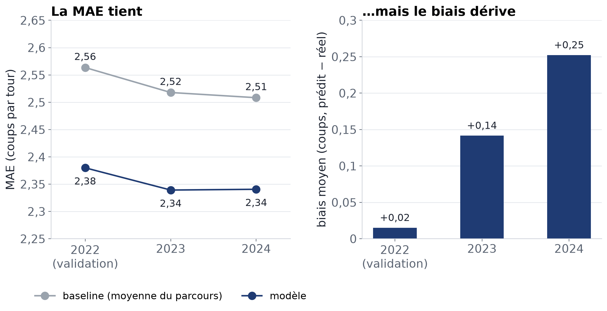
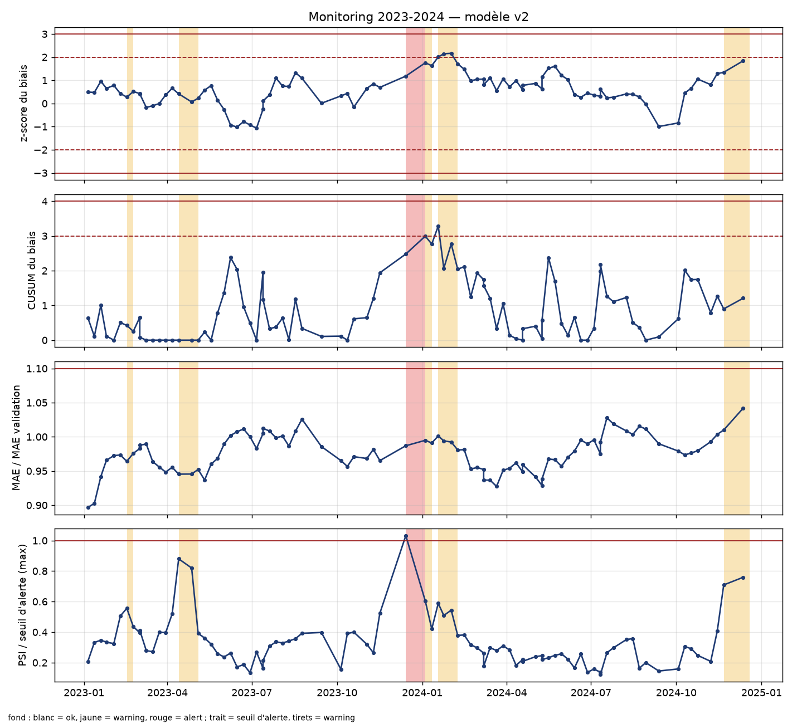
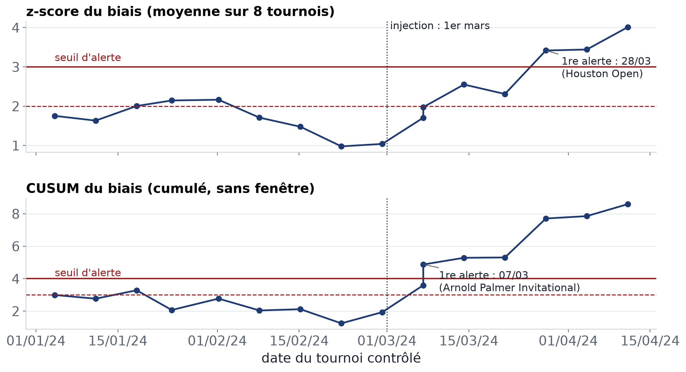
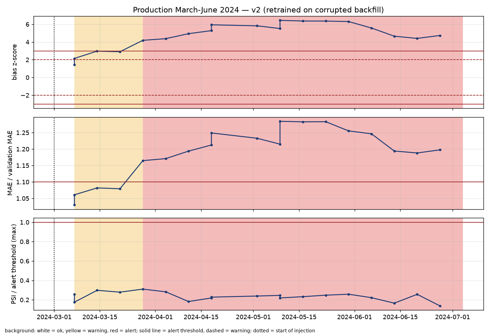
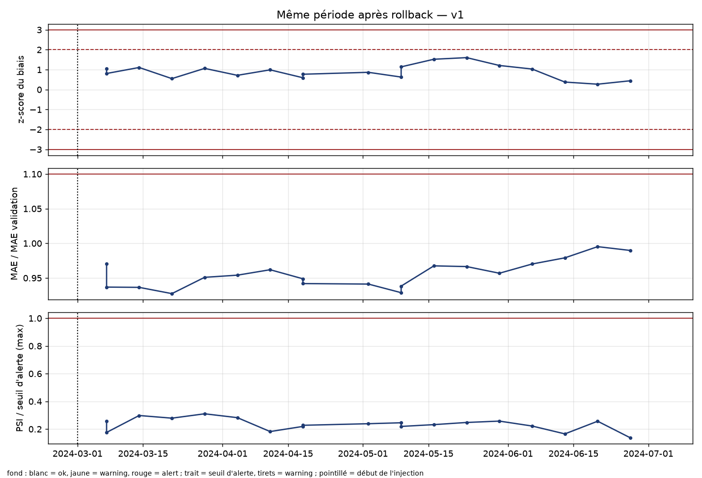
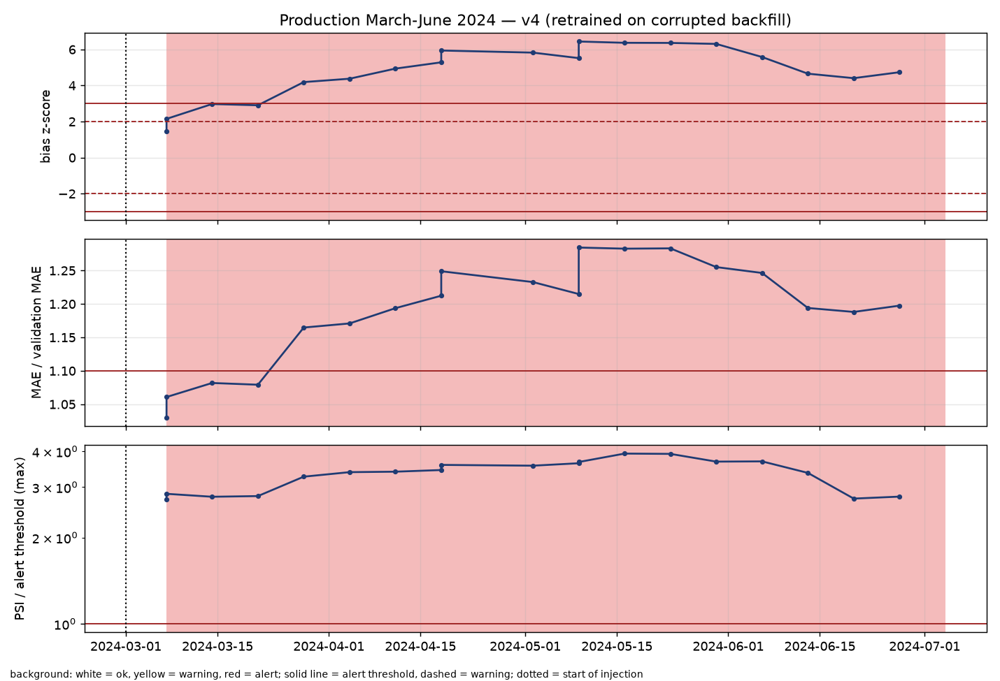

## Un modèle qui marche dans un notebook, personne n'y croit en production {data-part="Introduction"}

- Quelles données l'ont entraîné ?
- Marche-t-il encore ?
- Comment revenir en arrière quand il casse ?

. . .

[Notre réponse : un système **reproductible**, **surveillé** et **réversible**, et l'histoire du jour où il a cassé.]{.accroche}

::: notes
**Nicolas · 0:15.** On part de la phrase de la consigne : un modèle qui marche dans un notebook, personne n'y croit en production. Pendant 12 minutes on va vous montrer comment on a répondu à ces trois questions, puis vous raconter l'incident qu'on a provoqué. Léo commence par le problème.
:::


## Prédire un tour de golf, coup par coup {data-part="1 · Le problème"}

[Avant chaque tour, combien de coups au-dessus ou en dessous du par ?]{.accroche}

- **Cible** : `to_par` de chaque joueur, à chaque tour du PGA Tour
- **Entrées** : forme récente (relative au field), historique sur le parcours, difficulté du parcours, **météo prévue** sur la fenêtre de départ
- **Données** : 154 943 joueur-tours, 388 tournois, 2016-2024, sources publiques sans clé (ESPN, Open-Meteo, OpenStreetMap)
- Exemple : Scottie Scheffler, Masters 2024, 1er tour : **66, soit −6**

::: notes
**Léo · 0:35.** On prédit le score par rapport au par de chaque joueur, à chaque tour. Le modèle ne voit que ce qu'on sait avant le départ : la forme du joueur, son historique sur le parcours, et la météo prévue, pas observée. Toutes les sources sont gratuites et sans clé, donc n'importe qui peut reconstruire les données. On reviendra à Scheffler pendant la partie API.
:::

## Un bon terrain pour du MLOps {data-part="1 · Le problème"}

- **Prévu ≠ observé** : le modèle reçoit la météo prévue, la météo observée sert seulement au monitoring
- **Le monde dérive tout seul** : le field joue de plus en plus bas, moyenne **−0,40** en 2022, **−0,77** en 2024
- **Des ruptures réelles** : saison Covid 2020, Q-School de fin d'année
- **Des pannes plausibles** : une API météo, une unité, un backfill

::: notes
**Léo · 0:25.** Ce sujet nous plaît pour du MLOps parce que le drift y est naturel. Le niveau du field baisse année après année : un modèle entraîné sur 2018-2022 devient pessimiste sans qu'on touche à rien. Et la chaîne de données dépend d'une API météo externe, exactement le genre d'endroit où une panne silencieuse arrive.
:::

## 2,38 coups d'erreur, déjà 7 % de mieux que la baseline {data-part="1 · Le problème"}

:::: {.columns}
::: {.column width="45%"}
[2,380]{.big}

MAE de validation 2022, en coups par tour

[2,564]{.big style="color:#9aa3ad"}

baseline : moyenne historique du parcours

**skill = 1 − MAE / MAE~baseline~ = +7,2 %**
:::
::: {.column width="55%"}
Pourquoi la **MAE** :

- lisible : « on se trompe de 2,4 coups par tour »
- robuste aux tours catastrophes (écart-type 3,3, max +22) que la RMSE élèverait au carré
- assez stable pour servir de **seuil d'alerte**
:::
::::

::: notes
**Léo · 0:35.** On a fixé la métrique avant d'entraîner quoi que ce soit : la MAE, en coups. Seule, elle ne veut rien dire, donc on la compare à une baseline naïve, la moyenne du parcours, et on rapporte le skill. 7 %, ça paraît peu, mais même la météo observée, qu'on n'a pas en production, ne fait gagner que 0,007 coup : un tour de golf est surtout du bruit. La consigne le dit : on n'a pas poli le modèle, on a poli les opérations.
:::


## Tout le système sur un schéma {data-part="2 · Le système"}

```{mermaid}
%%{init: {"themeVariables": {"fontSize": "24px", "fontFamily": "Helvetica Neue, Arial, sans-serif"}, "flowchart": {"padding": 18, "nodeSpacing": 28, "rankSpacing": 38}}}%%
flowchart LR
  S["Sources<br/>publiques"] -->|dvc repro| D[("features<br/>DVC")]
  D --> R["MLflow<br/>Registry<br/>champion · previous"]
  R --> A["API<br/>FastAPI"]
  A --> J[("journal")]
  J --> M["monitor<br/>PSI · biais<br/>MAE · CUSUM"]
  M --> T{"trigger"}
  T -->|réentraîner<br/>ou rollback| R
  R -.->|/reload| A
  classDef hot fill:#1f3b73,color:#fff,stroke:#1f3b73
  class R,A,M hot
```

[Tout tourne avec `docker compose up` : registry, API, MLflow. La CI rejoue lint, 114 tests et le build Docker à chaque PR.]{.small .muted}

::: notes
**Léo · 0:50.** Voici tout le système. Les données publiques passent par un pipeline DVC jusqu'à une table de features. L'entraînement logue chaque run dans MLflow et enregistre le modèle dans le Registry, avec deux alias : champion, le modèle servi, et previous, la cible d'un rollback. L'API sert le champion et journalise chaque prédiction ; le monitoring relit ce journal, et le déclencheur décide : rien, réentraîner, ou revenir en arrière. Dans tous les cas l'API recharge sans redémarrer.
:::


## Chaque run dit d'où il vient {data-part="3 · Reproductibilité"}

[Si on ne sait pas quelles données ont entraîné un modèle, on ne peut pas le croire.]{.accroche}

```text
run « powerful-hog-465 »  →  pga-score-model v1
  params   train_years=2018-2021  valid_years=2022  refit_years=2018-2022  n_features=23 …
  metrics  valid_mae=2.380  valid_skill=0.072  eval_2023_mae  eval_2024_bias … (31 au total)
  tags     git_commit=ef92e5f…  git_dirty=true
           data_hash=5134dacd392968b0681061650f3b5de2   ← même md5 que dvc.lock
  modèle   signature + reference_profile.json + tag valid_event_bias_sd=0.853
```

::: notes
**Léo · 0:35.** Voici un vrai run, tel qu'il est dans notre MLflow. Les hyperparamètres et les fenêtres d'années, 31 métriques, le commit git, et surtout le hash des données : c'est le même md5 que dans dvc.lock, donc on peut retrouver exactement la table qui a entraîné ce modèle. Ce run dit même git_dirty=true : il a été lancé avec du code non commité, et c'est précisément le rôle du tag de le dire. Le profil de référence et l'écart-type du biais voyagent avec le modèle : le monitoring s'en sert.
:::

## Le temps ne se mélange jamais {data-part="3 · Reproductibilité"}

::: {.split}
<div class="hist">2016-2017<br>historique des features</div>
<div class="ref">2018-2022<br>entraînement 2018-21 · validation 2022 · référence</div>
<div class="drift">2023-2024<br>période de drift</div>
:::

- Split **temporel**, jamais aléatoire ; la forme et le parcours n'utilisent que le passé
- Pipeline DVC en 7 étapes : `calendar → leaderboards → rounds → courses → weather → features → train`
- Clone neuf : `dvc pull` depuis la Release `data-v1`, ou `dvc repro` depuis les API (≈ 40 min)

::: notes
**Léo · 0:35.** Le découpage est temporel : 2016-2017 ne sert qu'à calculer l'historique, on entraîne sur 2018-2021, on décide sur 2022, puis le modèle enregistré est réentraîné sur toute la référence. 2023-2024, c'est la période de drift, jamais utilisée pour décider. Toutes les étapes sont dans DVC et idempotentes ; un clone neuf récupère les données au hash exact du dvc.lock. Nicolas va maintenant vous montrer comment ce modèle est servi.
:::


## Une requête, une réponse, une version {data-part="4 · L'API"}

[Réponse réelle de l'API pour Scheffler, 1er tour du Masters 2024 :]{.accroche}

```bash
curl -X POST localhost:8000/predict -d '{"rows": [{"event_id": "401580344", "player_id": "9478",
  "round": 1, "form_ewm": -2.64, "course_rel_mean": -1.47, "fc_wind_mean": 24.36, … }]}'
```

```json
{"model_version": "2",
 "predictions": [{"event_id": "401580344", "player_id": "9478", "round": 1, "prediction": -0.69}]}
```

- Entrées validées par Pydantic depuis `FEATURES` : absente → NaN, inconnue ou tour 5 → **422**, pas de modèle → **503**
- Prédit **−0,69** pour un field à +1,43 en moyenne ; il a joué **−6** : le bruit d'un tour

::: notes
**Nicolas · 0:40.** Voici une vraie requête, envoyée à notre API locale, pour le premier tour de Scheffler au Masters 2024, un jour de vent à 24 km/h prévus. Le modèle le place à −0,7, plus de deux coups sous la moyenne du field ; il a joué −6. C'est ça, une MAE de 2,4 : le modèle classe bien, mais un tour reste très bruité. La réponse dit toujours quelle version a prédit. Une entrée invalide, comme un tour 5, est rejetée en 422 avant d'atteindre le modèle.
:::

## Changer de modèle sans redémarrer {data-part="4 · L'API"}

```{mermaid}
%%{init: {"themeVariables": {"fontSize": "24px", "fontFamily": "Helvetica Neue, Arial, sans-serif"}, "flowchart": {"padding": 18, "nodeSpacing": 28, "rankSpacing": 38}}}%%
flowchart LR
  E(["entraînement"]) --> C["candidate"]
  C -->|bat le champion| CH["champion"]
  C -->|garde-fou| B["bloquée"]
  CH -->|nouveau champion| P["previous"]
  P -->|rollback| CH
  classDef hot fill:#1f3b73,color:#fff,stroke:#1f3b73
  class CH hot
```

- Promotion : MAE meilleure **et** biais pas pire, sur les mêmes tournois, garde-fous OK
- L'alias est résolu **en numéro de version** au chargement : `/health` et `/predict` disent qui sert
- `POST /reload` relit l'alias à chaud ; s'il échoue, **l'ancien modèle reste servi** ; protégé par `X-API-Key`

::: notes
**Nicolas · 0:35.** Le cycle de vie d'un modèle tient en deux alias. Un nouveau modèle n'est promu champion que s'il bat le champion actuel ; l'ancien devient previous. Le rollback est un simple échange des deux alias, symétrique : on peut l'annuler avec la même commande. Côté API, on résout l'alias en numéro de version au chargement, pour que la version annoncée soit vraiment celle qui a prédit. Et /reload ne casse jamais le service : en cas d'échec, l'ancien modèle continue de répondre.
:::

## Chaque prédiction laisse une trace {data-part="4 · L'API"}

- **Journal** `predictions.parquet` : horodatage, clés, `model_version`, prédiction, toutes les entrées → c'est l'entrée du monitoring
- **`GET /metrics`** au format Prometheus : requêtes par route et statut, latence, lignes par version, rechargements, version servie
- **Tests d'intégration** : vrai modèle entraîné dans un MLflow temporaire ; version servie, journal, 422/503, rechargement après déplacement de l'alias, clé d'API
- **CI** à chaque PR : `ruff`, 114 tests sans données, build Docker + démarrage du service

::: notes
**Nicolas · 0:25.** Chaque appel à /predict ajoute ses lignes au journal, avec les entrées réellement reçues. C'est important pour la suite : le monitoring et le déclencheur lisent ce que la production a vraiment vu, pas une table qu'un backfill peut réécrire. Les tests de l'API ne sont pas des mocks : ils entraînent un vrai petit modèle dans un MLflow temporaire et déplacent l'alias pour vérifier que l'API suit. Léo, le monitoring.
:::


## Quatre signaux, deux familles {data-part="5 · Le monitoring"}

[Après chaque tournoi, on contrôle les 8 derniers (≈ 2 mois de saison, ≈ 3 000 joueur-tours).]{.accroche}

| Signal | Disponible | Ce qu'il mesure | Warning / alerte |
|---|---|---|---|
| **PSI** par feature | dès la prédiction | entrées vs données d'entraînement du champion | seuil calibré par feature |
| **z-score du biais** | quand les scores tombent | biais moyen / son bruit attendu | \|z\| > 2 / 3 |
| **Ratio de MAE** | quand les scores tombent | MAE fenêtre / MAE de validation | — / > 1,10 |
| **CUSUM du biais** | quand les scores tombent | petit biais qui s'accumule, sans fenêtre | S > 3 / 4 |

::: notes
**Léo · 0:35.** On a deux familles de signaux. Le PSI regarde les entrées : il est disponible tout de suite, mais il ne dit pas si le modèle se trompe. Les trois autres regardent la performance, une fois les scores publiés. Le statut est le pire des quatre, avec un code de sortie 0, 1 ou 2, ce qui permet de les brancher sur un cron ou une CI. Et les seuils de performance sont lus dans les tags du champion : après un rollback, ils suivent le modèle servi.
:::

## Des seuils usuels qui sonnaient 53 fois sur 89 {data-part="5 · Le monitoring"}

- Avec les seuils PSI classiques **0,1 / 0,25**, le replay 2023-2024 levait des alertes sur **53 contrôles sur 89**
- La météo de 8 tournois dépend de la saison et de la région : Hawaï en janvier ≠ Écosse en juillet
- **Calibration** sur 204 fenêtres de 2018-2022 : warning = quantile 99 % du PSI naturel, alerte = 1,5 × le max
- Exemple, vent prévu : **0,97 / 1,57** au lieu de 0,10 / 0,25
- Même logique pour le biais : écart-type **0,85 coup** par tournoi, un seuil fixe de 0,2 sonnerait une fois sur deux

::: notes
**Léo · 0:25.** Notre premier monitoring sonnait tout le temps : avec les seuils de manuel, 53 contrôles sur 89 en alerte. Un monitoring qui sonne tout le temps, personne ne le lit. On a donc mesuré le PSI naturel sur la période de référence, et fixé les seuils au-delà de ce qu'on y observe. Pour le biais, c'est pareil : tout le field d'un tournoi partage la météo, donc on rapporte le biais à son bruit, d'où le z-score.
:::

## La MAE tient, le biais dérive {data-part="5 · Le monitoring"}

{fig-align="center" height="620px"}

[Source : `reports/metrics.json`, modèle entraîné sur 2018-2022.]{.small .muted}

::: notes
**Léo · 0:25.** Voilà pourquoi on suit le biais et pas seulement la MAE. Sur 2023 et 2024, la MAE ne bouge pas, elle s'améliore même un peu. Mais le biais passe de quasi zéro à +0,25 coup : le field joue plus bas, et le modèle reste sur les niveaux de 2018-2022. Avec la MAE seule, cette dérive passerait inaperçue.
:::

## 2023-2024 : 79 ok, 9 warnings, 1 alerte {data-part="5 · Le monitoring"}

:::: {.columns}
::: {.column width="58%"}
{height="680px"}
:::
::: {.column width="42%"}
- **89 contrôles**, un par tournoi
- **Seule alerte** : le Q-School de décembre 2023, un field sans historique PGA Tour
- **Warnings de biais** en janvier 2024 : +0,61 à +0,65 coup
- MAE toujours sous 1,05 × la validation
- → réentraînement planifié, pas d'urgence
:::
::::

::: notes
**Léo · 0:25.** On a rejoué tout 2023-2024 tournoi par tournoi. Sur 89 contrôles : 79 ok, 9 warnings, une seule alerte. Cette alerte, c'est le Q-School, un tournoi de qualification avec des joueurs que le modèle n'a jamais vus : une vraie nouvelle population, pas un faux positif. Les warnings de janvier 2024, c'est la dérive du biais du slide précédent. Lente, détectée au niveau warning : elle justifie un réentraînement planifié, pas une urgence.
:::

## Le CUSUM voit 3 semaines plus tôt {data-part="5 · Le monitoring"}

{fig-align="center" height="600px"}

[Scénario injecté : vent prévu +15 km/h à partir du 1er mars 2024 (`timeline_incident.csv`).]{.small .muted}

::: notes
**Léo · 0:25.** Le z-score fait une moyenne sur 8 tournois : un biais qui apparaît est dilué par les tournois sains. Ici, on injecte +15 km/h de vent prévu au 1er mars : le z-score n'alerte que le 28 mars. Le CUSUM, lui, accumule les petits écarts : alerte le 7 mars, dès la première semaine touchée, sans aucune alerte de plus sur le drift naturel. Honnêtement : il entre en mars déjà à 1,9, chargé par la dérive de janvier, ce qui l'aide ici.
:::

## Réentraîner, revenir en arrière, ou ne rien faire ? {data-part="5 · Le monitoring"}

```{mermaid}
%%{init: {"themeVariables": {"fontSize": "22px", "fontFamily": "Helvetica Neue, Arial, sans-serif"}, "flowchart": {"padding": 18, "nodeSpacing": 28, "rankSpacing": 38}}}%%
flowchart LR
  P{"Alerte PSI ?"} -->|oui| R1{"Champion<br/>< 60 j ?"}
  R1 -->|oui| RB1["Rollback · 30"]
  R1 -->|non| DI["Incident de données · 20<br/>pas de réentraînement"]
  P -->|non| D{"Biais/MAE<br/>dégradés ?"}
  D -->|non| N["Rien · 0"]
  D -->|oui| R2{"Champion<br/>< 60 j ?"}
  R2 -->|oui| RB2["Rollback · 30"]
  R2 -->|non| RT["Réentraînement · 10"]
```

::: {.callout-box}
**Cas réel, lundi 5 février 2024** : 3 warnings de biais d'affilée → réentraînement. Sur les mêmes 8 tournois, challenger **2,326** contre 2,362 (MAE), biais **+0,48** contre +0,62 → **promu**.
:::

::: notes
**Léo · 0:35.** Le déclencheur suit un arbre simple. Une dégradation juste après une mise en service accuse ce déploiement : on revient en arrière. Une alerte sur les entrées d'un vieux champion, c'est un problème de données : réentraîner apprendrait le bug. Une dérive confirmée sur un vieux champion : on réentraîne, et le challenger doit battre le champion sur les mêmes tournois. C'est ce qui s'est passé le 5 février 2024 avec la dérive de janvier. Et c'est ce mécanisme qui va nous trahir : Nicolas.
:::


## 1er mars 2024 : le mauvais modèle gagne {data-part="6 · L'incident"}

[Un réentraînement de routine, sur un backfill météo re-téléchargé… en m/s au lieu de km/h.]{.accroche}

- `wind_speed_unit=ms` : vent et rafales **divisés par 3,6** sur tout l'historique
- La fenêtre de décision vient du même backfill. Sur 8 tournois (2 959 joueur-tours) :

| | MAE | biais |
|---|---|---|
| v2, réentraîné sur le backfill corrompu | **2,261** | +0,045 |
| v1, champion sain | 2,316 | −0,285 |

- v2 gagne la comparaison et **devient champion**

::: notes
**Nicolas · 0:25.** Voici l'incident qu'on a simulé, dans un registry à part. Le 1er mars, réentraînement de routine. Mais le backfill météo a été re-téléchargé avec une option d'unité en m/s : tout le vent est divisé par 3,6. Le problème, c'est que la comparaison de promotion utilise les mêmes données corrompues. Le nouveau modèle gagne, nettement, et il est promu. Rien n'a crié.
:::

## Mars 2024, semaine après semaine {data-part="6 · L'incident"}

| Date | Ce qui se passe | Signal |
|---|---|---|
| **1er mars** | v2 promu champion | aucun |
| **7 mars** | 1ers tournois servis par v2 : Arnold Palmer ok, Puerto Rico Open… | [warning]{.accent} biais +0,65, z = 2,15 |
| 14 mars | THE PLAYERS | warning, biais +0,90, z = 2,97 |
| 21 mars | Valspar | warning, biais +0,88, z = 2,90 |
| **25 mars** | 3 warnings d'affilée, 24 jours après la promotion | [**rollback** v2 → v1]{.alert-txt} |
| 28 mars | Houston Open : la 1re alerte qui aurait sonné | z = 4,19, MAE × 1,165 |

::: notes
**Nicolas · 0:35.** Dès les premiers tournois servis par v2, le 7 mars, le biais passe en warning. Il y reste les deux semaines suivantes. Le lundi 25 mars, le déclencheur voit trois contrôles dégradés, 24 jours après une mise en service : il accuse ce déploiement et fait le rollback, tout seul. La première vraie alerte du monitoring ne serait arrivée que le 28 mars : le rollback a eu lieu avant.
:::

## Le biais a sonné. Le PSI n'a rien vu, et c'est normal {data-part="6 · L'incident"}

:::: {.columns}
::: {.column width="62%"}
{height="640px"}
:::
::: {.column width="38%"}
- **z-score du biais** : warning dès le 7 mars
- **MAE** : ne passe le seuil × 1,10 que le 28 mars
- **PSI** : **0 alerte sur 19 contrôles**, ratio max **0,31**
- Pourquoi : la production et la référence 2018-2022 sont **saines**. Le bug n'est pas dans les entrées, il est dans **ce que v2 a appris**
:::
::::

::: notes
**Nicolas · 0:35.** En haut, le z-score du biais, qui a sonné. Au milieu, la MAE, plus lente. En bas, le PSI : plat, zéro alerte sur 19 contrôles. Ce n'est pas un bug du PSI. Il compare les entrées de production à la référence 2018-2022, et les deux sont saines, en km/h. La corruption est dans les données d'entraînement du modèle servi, qu'aucun signal d'entrée ne regardait. C'est la leçon principale de l'incident.
:::

## Un vent divisé par 3,6, un biais multiplié {data-part="6 · L'incident"}

- **Cause racine** : backfill téléchargé avec `wind_speed_unit=ms`, sans contrôle d'unité ni de plage à l'ingestion
- **Pourquoi la promotion n'a rien vu** : le modèle découpe chaque feature par quantiles, une division par 3,6 **partout** ne change rien pour lui. En production, le vent arrive en km/h, soit environ 3,6 fois plus que tout ce que v2 a vu
- **Impact** : sur les tournois des 7, 14 et 21 mars, servis par v2, le biais de la fenêtre passe de **+0,44 à +0,90 coup** par joueur-tour
- **Sans rollback** : biais jusqu'à **+1,94 coup** et MAE × 1,28 en mai, 15 alertes sur 19 contrôles

::: notes
**Nicolas · 0:25.** La cause racine est banale : un paramètre d'unité dans un appel d'API. Le modèle de gradient boosting découpe par quantiles : si le vent est divisé par 3,6 partout, il s'en moque. C'est en production, où le vent revient en km/h, que tout se décale : v2 surestime les scores. L'impact réel a été limité à trois semaines ; sans rollback, on serait monté à presque 2 coups de biais.
:::

## Rollback le 25 mars, 19 contrôles ok sur 19 {data-part="6 · L'incident"}

:::: {.columns}
::: {.column width="62%"}
{height="640px"}
:::
::: {.column width="38%"}
- `pga.trigger` → code **30** : `champion` ← v1, `previous` ← v2
- Tags `rolled_back_from`, `rollback_reason`, run de trace dans `pga-operations`
- L'API recharge, la commande vérifie `/health`
- **Pas de réentraînement** : on réapprendrait le bug
- Rejoué avec v1 : z-score max **1,6**, MAE toujours sous la validation
:::
::::

::: notes
**Nicolas · 0:25.** Le rollback, c'est un échange d'alias, tracé dans MLflow, suivi d'un rechargement de l'API et d'une vérification. On n'a pas réentraîné : sur les mêmes données, on aurait reproduit le bug. Pour vérifier, on a rejoué la même période avec v1 : 19 contrôles sur 19 ok, et les seuils utilisés sont bien ceux de v1, puisqu'ils sont lus sur le champion.
:::

## La même panne, après nos 5 correctifs {data-part="6 · L'incident"}

| | Avant correctifs | Après correctifs |
|---|---|---|
| Backfill au 1er mars | promu (2,261 contre 2,316) | **refusé** : médiane du vent 3,0 km/h hors [6, 20] ; PSI vent 5,20 > 1,57 |
| Si on le force : alertes PSI | 0 sur 19 | **19 sur 19** |
| Première alerte | 28 mars | **7 mars** |
| Rollback | 25 mars | **11 mars** |

[Correctifs : contrôle d'unité à l'ingestion · PSI contre les données d'entraînement **du modèle servi** · promotion bloquée si les données du challenger s'écartent · alerte PSI après promotion → rollback · comparaison sur le **journal de l'API** (là, v2 perd seul : 2,652 contre 2,268).]{.small}

::: notes
**Nicolas · 0:25.** On a rejoué exactement la même panne après correctifs. Le backfill est refusé dès la promotion : la médiane du vent à 3 km/h est hors plage. Si on force quand même, le PSI, qui compare maintenant aux données d'entraînement du modèle servi, alerte dès le premier tournoi, et le rollback a lieu le 11 au lieu du 25. Et comparé sur le journal de l'API, donc sur ce que la production a vraiment vu, le challenger corrompu perd à lui seul.
:::


## Ce que vous allez voir {data-part="7 · Démo"}

```bash
bash scripts/demo.sh --prepare     # avant l'oral : le champion est la version corrompue
bash scripts/demo.sh               # en direct, une pause par étape
```

1. `/health` : l'API sert **v2**, la version corrompue
2. 3 442 prédictions de mars-avril 2024 envoyées à `/predict`
3. `monitor check` → **ALERT** (biais +1,79, z = 5,9)
4. `trigger` → **rollback** v2 → v1, l'API recharge ; `/health` → **v1**
5. Mêmes requêtes → **OK** ; le même backfill aujourd'hui → **refusé**

::: notes
**Nicolas · 0:15 + démo ≈ 2 min.** Je lance la démo ; elle rejoue l'incident dans le registry isolé de l'incident, avec le code d'aujourd'hui. Attention à une différence avec l'histoire : comme les correctifs sont en place, le PSI alerte aussi, puisqu'il compare maintenant aux données d'entraînement de v2. Si la démo plante : plan B en annexe, avec la sortie réelle de cette même commande.
:::


## Nos choix, et ce qu'ils nous coûtent {data-part="8 · Choix et compromis"}

| Choix | Alternative écartée | Pourquoi / ce qu'on accepte |
|---|---|---|
| Remote DVC local + Release GitHub | Google Drive | OAuth de DVC bloqué par Google ; pas de stockage partagé |
| Gradient boosting, perte MAE | modèle plus poussé | optimise la MAE, gère les NaN ; les autres pistes testées n'ont rien gagné |
| Seuils PSI calibrés par feature | 0,1 / 0,25 usuels | 53 alertes sur 89 sinon ; seuils propres à notre référence |
| Biais en z-score + CUSUM | seuil fixe sur la MAE | la MAE ne voit pas la dérive ; CUSUM pas encore dans le déclencheur |
| Fenêtre de 8 tournois | fenêtre courte | peu de fausses alertes, mais 4 tournois pour voir l'incident |
| Rollback si dégradation < 60 j | toujours réentraîner | ne réapprend pas un bug ; suppose un `previous` sain |

::: notes
**Léo puis Nicolas · 0:50.** Léo prend les trois premières lignes, Nicolas les trois dernières. Chaque choix a un prix qu'on a accepté en connaissance de cause. Par exemple, la fenêtre de 8 tournois nous évite les fausses alertes, mais c'est elle qui a mis 4 tournois à voir l'incident ; le CUSUM compense, mais il ne pilote pas encore le déclencheur. Et notre règle de rollback suppose que la version précédente est saine.
:::

## Avec un mois de plus {data-part="9 · La suite"}

- **Le CUSUM dans le déclencheur** : aujourd'hui il accélère l'alerte, pas encore la décision automatique
- **Des données vivantes** : un `dvc repro` planifié avant chaque déclenchement, au-delà de la saison 2024
- **Surveiller la cible** : une corruption des scores ne change pas les features, nos garde-fous ne la voient pas
- **Déploiement progressif** : le challenger d'abord en ombre, comparé sur le journal avant d'être servi
- **Infrastructure partagée** : serveur MLflow et stockage DVC distants, tableau de bord sur `/metrics`

. . .

[Reproductible, surveillé, réversible : et quand il a cassé, on a su pourquoi.]{.accroche}

::: notes
**Nicolas · 0:35.** Avec un mois de plus, on fermerait d'abord les limites qu'on a nous-mêmes documentées : brancher le CUSUM sur la décision, alimenter le système avec des données récentes, et surveiller la cible, que nos garde-fous actuels ne voient pas. Ensuite, déployer les challengers en ombre plutôt que directement. Pour conclure : on n'a pas le meilleur modèle de golf, mais on sait d'où il vient, on sait quand il se trompe, et on sait revenir en arrière. Merci, on prend vos questions.
:::


## Plan B · sortie réelle de la démo (1/2) {data-part="Annexe"}

```{.text .tiny}
▶ 1. L'API sert le champion actuel
{"status":"ok","model_name":"pga-score-model","model_alias":"champion","model_version":"2","detail":null}

▶ 2. Production : les tournois de mars-avril 2024 envoyés à /predict
3442 prédictions (9 tournois, 2024-03-01 -> 2024-04-21) servies par v2

▶ 3. Monitoring sur le journal de l'API (scores réels connus)
statut : ALERT  (modèle v2, dernier tournoi : Corales Puntacana Championship)
  PSI max 5.6167 (fc_wind_mean) | biais 1.7925 (z 5.941) | MAE ratio 1.2489
  - [alert] PSI fc_gust_max = 7.05 > 3.26
  - [alert] PSI fc_wind_mean = 5.62 > 1.57
  - [alert] biais +1.79 coup (z = +5.9, seuil 3.0)
  - [alert] MAE 2.82 = 1.25 x validation (seuil 1.1)
  - [alert] CUSUM du biais 13.7 > 4.0 (prédictions trop hautes)
```

::: notes
**Plan B.** Si la démo ne démarre pas, on montre cette sortie, obtenue avec `bash scripts/demo.sh --no-pause` sur la même machine.
:::

## Plan B · sortie réelle de la démo (2/2) {data-part="Annexe"}

```{.text .tiny}
▶ 4. Le déclencheur décide et agit (rollback + rechargement de l'API)
[2024-04-22] champion v2 -> action : ROLLBACK
  alerte PSI juste après la mise en service de v2 (2024-03-01) : [alert] PSI fc_gust_max = 7.05 > 3.26 | …
  rollback v2 -> v1

▶ 5. L'API sert la version saine
{"status":"ok","model_name":"pga-score-model","model_alias":"champion","model_version":"1","detail":null}

▶ 6. Mêmes requêtes, puis monitoring : retour dans les seuils
3442 prédictions (9 tournois, 2024-03-01 -> 2024-04-21) servies par v1
statut : OK  (modèle v1, dernier tournoi : Corales Puntacana Championship)
  PSI max 0.0569 (form_rel_long) | biais 0.2323 (z 0.77) | MAE ratio 0.9419

▶ 7. Le même backfill aujourd'hui : refusé à la promotion
challenger v3 : REFUSÉ, le champion reste v1
  - médiane du vent 3.0 km/h hors de la plage [6, 20]
  - PSI fc_gust_max = 6.05 > 3.26
  - PSI fc_wind_mean = 5.20 > 1.57
```

::: notes
**Plan B (suite).** Après la démo, relancer `bash scripts/demo.sh --prepare` pour remettre le registry dans l'état « incident ».
:::

## Plan B · captures {data-part="Annexe"}

:::: {.columns}
::: {.column width="50%"}
{width="100%"}
:::
::: {.column width="50%"}
{width="100%"}
:::
::::

::: notes
**Plan B.** À gauche, l'interface Swagger de l'API ; à droite, l'incident rejoué avec les correctifs, où le PSI alerte dès le premier tournoi.
:::

## Détail des seuils {data-part="Annexe"}

:::: {.columns}
::: {.column width="48%"}
| Feature | warning | alerte |
|---|---|---|
| `form_rel_short`, `form_ewm` | 0,10 | 0,25 |
| `form_rel_long` | 0,14 | 0,25 |
| `form_rel_xlong` | 0,21 | 0,42 |
| `form_ewm_slow` | 0,18 | 0,30 |
| `days_since_last` | 1,01 | 1,67 |
| `course_rel_mean` | 0,37 | 0,67 |
| `fc_temp_mean` | 2,51 | 4,02 |
| `fc_humidity_mean` | 1,54 | 2,80 |
| `fc_precip_sum` | 0,72 | 1,10 |
| `fc_wind_mean` | 0,97 | 1,57 |
| `fc_gust_max` | 1,46 | 3,26 |

: {.compact}
:::
::: {.column width="52%"}
[**Performance** (tags du champion)]{.small}

- [z-score du biais : warning 2, alerte 3, σ~tournoi~ = 0,85 coup]{.small}
- [ratio de MAE : alerte > 1,10 (≈ 3 erreurs-types sur 8 tournois)]{.small}
- [CUSUM : k = 0,5, warning 3, alerte 4. Vérifié hors échantillon 2019-2022 (167 tournois) : toutes les alertes en 2020, saison Covid]{.small}
- [moins de 500 lignes : signaux non évalués]{.small}

[**Déclencheur** : 3 contrôles consécutifs, promotion récente < 60 jours]{.small}
:::
::::

::: notes
Pour les questions sur les seuils. Source : `reports/monitoring/calibration.json`, `params.yaml`, `docs/monitoring.md`.
:::

## Répartition du travail {data-part="Annexe"}

| Bloc | Responsable | Fichiers |
|---|---|---|
| API FastAPI, tests d'intégration, journal des prédictions | **Nicolas** | `src/pga/api.py`, `tests/test_api.py` |
| Monitoring du drift | **Léo** | `src/pga/monitor.py`, `tests/test_monitor.py` |
| Rollback et runbook | **Léo** | `src/pga/rollback.py`, `docs/runbook.md` |
| Déclencheur, incident simulé, test « clone neuf », slides | **ensemble** | `src/pga/trigger.py`, `docs/incident.md` |

[Une branche et une PR par bloc, relue par l'autre avant le merge.]{.small .muted}

::: notes
Source : `docs/architecture.md`.
:::

## Reproduire depuis un clone neuf {data-part="Annexe"}

```bash
git clone https://github.com/lbouchand-eng/2026-2027_mlops_nl.git && cd 2026-2027_mlops_nl
gh release download data-v1 -p pga-dvcstore.tar.gz -D ..   # données versionnées (store DVC)
tar xzf ../pga-dvcstore.tar.gz -C ..
uv sync && uv run dvc pull                                 # data/ aux hash exacts de dvc.lock
docker compose up --build                                  # registry, API (:8000), MLflow (:5001)
docker compose run --rm --build demo                       # la démo de l'incident
```

- Aucune clé d'API, aucun secret ; `.env` et `.dvc/config.local` ignorés par git
- Sans Docker : `uv run pytest` (114 tests), `bash scripts/demo_setup.sh`, `uv run uvicorn pga.api:app`

::: notes
Source : `README.md`, section « Démarrage rapide ».
:::
