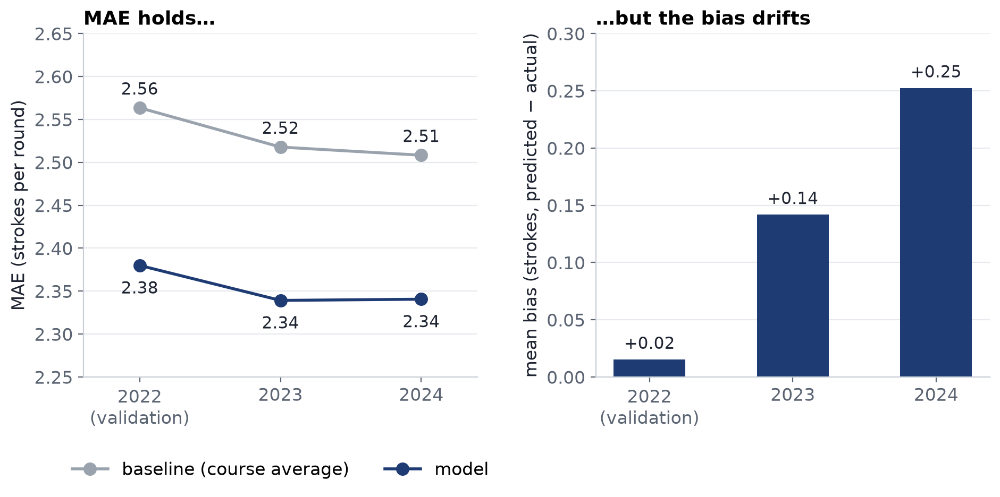
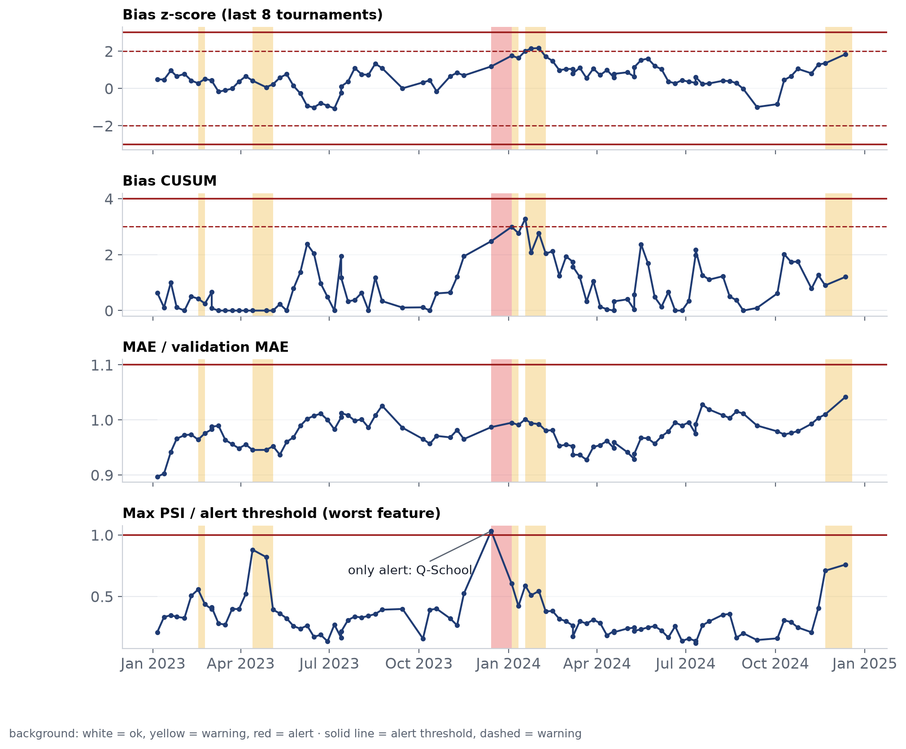
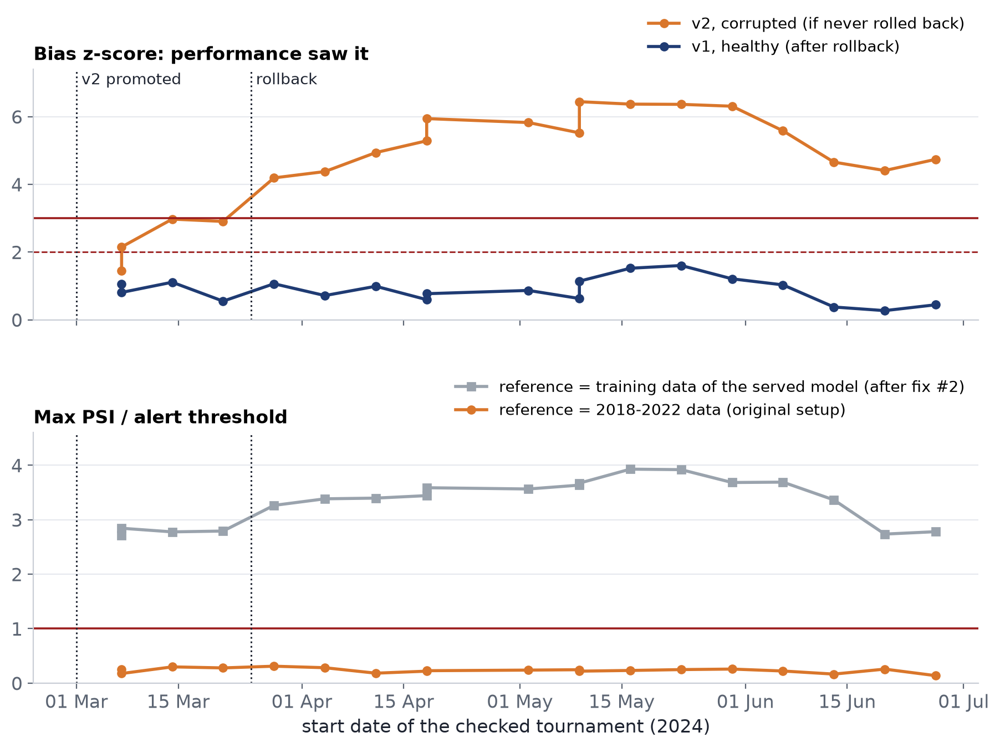

::: {.lead}
A forecasting model that works in a notebook is not trusted in production: nobody can say which data trained it, whether it still works, or how to undo it when it breaks. This project takes a deliberately simple model, predicting each PGA Tour player's score on each round, and builds the operations around it: versioned data, tracked runs, a model registry, a serving API, drift monitoring, a retraining trigger and a one-command rollback. Then we broke it on purpose and wrote up what happened.
:::

::: {.callout-note appearance="default" icon="false"}
## At a glance

| | |
|---|---------|
| **Task** | Predict `to_par` (strokes relative to par) for every player-round of the PGA Tour, before the round starts |
| **Data** | 154,943 player-rounds, 388 tournaments, 2016-2024, from free public APIs without keys (ESPN, Open-Meteo, OpenStreetMap) |
| **Model** | `HistGradientBoostingRegressor` with an absolute-error loss: validation MAE **2.380** strokes, **7.2 %** better than a naive baseline |
| **Stack** | DVC · MLflow tracking and Model Registry · FastAPI · Prometheus metrics · Docker Compose · GitHub Actions |
| **Monitoring** | Per-feature PSI with calibrated thresholds, bias z-score, MAE ratio and bias CUSUM, after every tournament |
| **Incident** | A wind backfill in m/s instead of km/h got promoted; the trigger rolled it back automatically after 4 tournaments |
| **Tests** | 114 tests, run in CI on every pull request, without data or a local MLflow |
:::

# The problem

## What we predict

For every player and every round, the model predicts the score relative to par (`to_par`, in strokes). It only sees what is known **before** the player tees off:

- **recent form**, relative to the field (short, long and exponentially weighted windows over the player's previous rounds);
- **course history**: the player's past results on the course and the course's past difficulty, from previous editions only;
- **forecast weather** over the player's tee-time window: temperature, humidity, precipitation, mean wind and gusts;
- **context**: round number, major, multi-course event, course length and par.

A concrete example: Scottie Scheffler opened the 2024 Masters with a **66 (−6)**, on a day with 24.36 km/h of forecast wind. Section [-@sec-api] shows what the model said before that round.

## Why golf is a good MLOps playground

- **Forecast ≠ observed.** The model is fed the archived weather *forecast*; the *observed* weather (ERA5) is only used by monitoring, to measure the forecast error. Training on observed weather would be a leak that production cannot reproduce.
- **The world drifts on its own.** The field keeps scoring lower: the mean `to_par` went from **−0.40** in 2022 to **−0.77** in 2024. A model trained on 2018-2022 slowly becomes pessimistic without anyone touching it.
- **Real breaks exist.** The 2020 Covid season and the year-end Q-School (a qualifying event full of players without a PGA Tour history) are genuine distribution shifts.
- **Plausible failures.** The pipeline depends on an external weather API; a unit or a parameter changing in a backfill is exactly the kind of silent failure operations must catch.

## Metric: MAE in strokes, against a baseline

The metric was fixed before any training (`docs/metric.md`).

**Primary metric: MAE on `to_par`, in strokes.** It is readable by anyone ("the model is off by 2.4 strokes per round"), robust to catastrophic rounds (the target has a standard deviation of 3.3 and a maximum of +22; an RMSE would square them and let a handful of rows drive model selection and alerts), and stable enough over time to be used as a production alert threshold.

**Baseline**: the historical mean `to_par` of the course (previous editions only, 0 for a new course). It knows neither the player nor the weather. We report a **skill score**, `skill = 1 − MAE / MAE_baseline`.

**Promotion rule**: a model enters the registry as champion only if its validation skill is strictly positive and it beats the current champion.

| Year | MAE baseline | MAE "predict 0" | RMSE baseline |
|---|---|---|---|
| 2021 | 2.527 | 2.626 | 3.224 |
| 2022 | 2.564 | 2.666 | 3.247 |
| 2023 | 2.518 | 2.642 | 3.204 |
| 2024 | 2.508 | 2.717 | 3.182 |

: Baselines per year (`docs/metric.md`).

Secondary metrics are logged but do not drive decisions: RMSE, **mean bias** (`mean(ŷ − y)`, a level-drift signal) and MAE per round.

# The system on one diagram

::: {.column-page}
```{mermaid}
flowchart LR
  S["ESPN · Open-Meteo<br/>OSM"] -->|dvc repro| D[("features<br/>DVC")]
  D -->|pga.train| R["MLflow Registry<br/>champion · previous"]
  R -->|loads champion| A["FastAPI<br/>/predict · /reload"]
  A --> J[("prediction<br/>log")]
  J --> M["pga.monitor<br/>PSI · bias · MAE · CUSUM"]
  M --> T{"pga.trigger"}
  T -->|retrain or rollback| R
  R -.->|POST /reload| A
  classDef hot fill:#1f3b73,color:#fff,stroke:#1f3b73
  class R,A,M hot
```
:::

Public data goes through a DVC pipeline into one feature table. Training logs every run to MLflow and registers the model under two aliases: **`champion`**, the model being served, and **`previous`**, the rollback target. The API serves the champion and logs every prediction; monitoring reads that log, and the trigger decides whether to do nothing, retrain, or roll back. In every case the API reloads without restarting.

`docker compose up` starts the whole stack (registry bootstrap, API, MLflow UI). An `ops` profile adds a weekly scheduler that runs the trigger and applies its decisions.

# Reproducibility

## Data pipeline (DVC)

| Stage | Script | Output |
|---|----|-------|
| `calendar` | `src/pga/calendar.py` | `data/interim/events.parquet` (one call per season) |
| `leaderboards` | `src/pga/leaderboards.py` | `data/raw/espn/leaderboard/{event_id}.json` |
| `rounds` | `src/pga/rounds.py` | `data/processed/rounds.parquet` |
| `courses` | `src/pga/geocode.py` | `data/interim/courses.parquet` |
| `weather` | `src/pga/weather.py` | `data/processed/weather_rounds.parquet` |
| `features` | `src/pga/features.py` | `data/processed/features.parquet` |
| `train` | `src/pga/train.py` | MLflow run + registry version, `reports/metrics.json` |

: The seven DVC stages (`dvc.yaml`).

Every stage is idempotent: raw API responses are kept under `data/raw/` and reused, so an interrupted `dvc repro` restarts without losing work. A fresh clone gets the data either by rebuilding it from the public APIs (`dvc repro`, about 40 minutes) or by downloading the versioned DVC store from the `data-v1` GitHub Release and running `dvc pull`, which restores `data/` at the exact hashes of `dvc.lock`.

Cleaning choices (`rounds.py`): individual stroke play only (match play and team events excluded), playoff holes excluded, the last round of a player who withdrew or was disqualified removed, and `to_par` taken from ESPN's `displayValue`, which stays correct on multi-course events.

## No leakage, no shuffling

```{=html}
<div class="split">
  <div class="hist">2016-2017<br><span>feature history only</span></div>
  <div class="ref">2018-2022<br><span>train 2018-21 · validate 2022 · reference</span></div>
  <div class="drift">2023-2024<br><span>drift period</span></div>
</div>
```

The split is temporal, never random. Form features only use the player's earlier rounds; course history and difficulty only use previous editions; relative form is computed as `to_par − field mean (tournament, round)`. Observed weather (`obs_*`, `diff_*`) is reserved for monitoring. `tests/test_features.py` checks these rules. 2018 is the first year with complete forecast weather.

## Every run says where it comes from

Each training run logs its hyperparameters and year windows (params), MAE, RMSE, bias, skill and per-round MAE for validation and both drift years (31 metrics), and three tags that tie it to code and data. Here is the real run behind version 1 of `pga-score-model`:

```text
run "powerful-hog-465"  ->  pga-score-model v1
  params   train_years=2018-2021  valid_years=2022-2022
           refit_years=2018-2022  n_features=23  ...
  metrics  valid_mae=2.380  valid_skill=0.072  ...  (31 in total)
  tags     git_commit=ef92e5fa81e1...  git_dirty=true
           data_hash=5134dacd392968b0681061650f3b5de2  # = md5 in dvc.lock
  model    signature + reference_profile.json
  version  tag valid_event_bias_sd=0.853388
```

`data_hash` is the md5 of `features.parquet`, identical to the one in `dvc.lock`, so any model can be traced back to the exact table that trained it. `git_dirty=true` is not hidden: that run was launched with uncommitted changes, and saying so is precisely what the tag is for. The reference profile and the per-tournament bias standard deviation travel with the model, because monitoring needs them (section [-@sec-monitoring]).

# Model and training

The model is a `HistGradientBoostingRegressor(loss="absolute_error")`: it optimises the MAE directly and handles missing values natively (a new player has no form yet). Hyperparameters live in `params.yaml → train` (learning rate 0.05, 300 iterations, 31 leaf nodes, at least 200 samples per leaf, L2 regularisation 1.0).

**Protocol**: fit on 2018-2021, validate on 2022 (the decision), refit on 2018-2022 (the registered model), then evaluate on 2023 and 2024 for information only. The drift years are never used to decide anything.

| | Validation 2022 | 2023 | 2024 |
|---|---|---|---|
| MAE | 2.380 | 2.339 | 2.341 |
| Baseline MAE | 2.564 | 2.518 | 2.508 |
| Skill | +7.2 % | +7.1 % | +6.7 % |
| Mean bias | +0.015 | +0.142 | +0.252 |
| Player-rounds | 17,894 | 17,667 | 17,755 |

: Registered model, from `reports/metrics.json`.

{#fig-metrics width="95%"}

Seven percent sounds small, and it is honest. Extending the training window from 2021 alone to 2018-2021 was the only lever that mattered (validation MAE 2.411 → 2.380). Everything else we tried scored between 2.410 and 2.424: weather specific to the tee-time wave, field strength, the previous round of the same tournament, hyperparameter tuning, a squared loss. Even the **observed** weather, which production can never have, gains only 0.007 strokes. A single round of golf is dominated by irreducible noise, so we stopped polishing the model and polished the operations.

# Model registry and lifecycle

```{mermaid}
flowchart LR
  E(["training run"]) --> C["candidate"]
  C -->|beats the champion| CH["champion"]
  C -->|guard fails| B["blocked<br/>(tag blocked_reason)"]
  CH -->|a new champion is promoted| P["previous"]
  P -->|rollback| CH
  classDef hot fill:#1f3b73,color:#fff,stroke:#1f3b73
  class CH hot
```

The registered model is `pga-score-model`. A new version is promoted only if, **on the same tournaments**, its MAE is lower and its absolute bias is not worse than the champion's, and the promotion guards pass (section [-@sec-fixes]). The old champion becomes `previous`. A rollback swaps the two aliases, so it is symmetric: running the same command again undoes it. `uv run python scripts/registry_status.py` prints the versions and their aliases.

# Serving API {#sec-api}

## Endpoints

| Endpoint | Role |
|---|--------|
| `GET /health` | Status and the **version number** actually served |
| `POST /predict` | Predictions for a list of player-rounds; the response says which version predicted |
| `POST /reload` | Re-reads the `champion` alias without restarting; protected by `X-API-Key` when `PGA_API_KEY` is set |
| `GET /metrics` | Prometheus metrics |

: FastAPI service (`src/pga/api.py`), documented with Swagger at `/docs`.

## A real request

The request below is Scheffler's first round at the 2024 Masters, with every feature taken from `features.parquet` (abridged here), sent to the API running locally:

```bash
curl -s -X POST localhost:8000/predict \
  -H 'content-type: application/json' \
  -d '{"rows": [{"event_id": "401580344", "player_id": "9478", "round": 1,
                 "form_ewm": -2.64, "course_rel_mean": -1.47,
                 "fc_wind_mean": 24.36, "fc_gust_max": 50.8, ...}]}'
```

```json
{"model_version": "2",
 "predictions": [{"event_id": "401580344", "player_id": "9478",
                  "round": 1, "prediction": -0.69}]}
```

The model predicted **−0.69**, more than two strokes better than a field that averaged **+1.43** that day. Scheffler shot **−6**. The ranking is right; the size of the gap is the noise of a single round, which is what an MAE of 2.4 strokes means in practice. (Version 2 here is the champion of our local registry at the time of the request, the model retrained on 5 February 2024; another machine may serve another version.)

## Design details

- **Validated inputs.** The Pydantic schema is generated from `pga.features.FEATURES`, the single list of features shared by training, the API and monitoring. A missing or `null` feature becomes NaN (handled by the model); an unknown column, a wrong type or a round outside 1-4 returns **422**; no model returns **503**.
- **Loaded by version number.** The alias is resolved to a version when the model is loaded, so the version reported by `/health` and `/predict` is the one that actually predicted, even if the alias moves in the meantime.
- **Safe hot reload.** `/reload` loads the new champion before swapping it in; if loading fails, the previous model keeps serving.
- **Prediction log.** Every call appends its rows to `data/monitoring/predictions.parquet`: timestamp, keys, `model_version`, prediction and every input received. This is the input of monitoring, and it matters for the incident: it records what production actually saw, which a backfill cannot rewrite.
- **Prometheus metrics**: `pga_http_requests_total{path,status}`, `pga_predict_latency_seconds`, `pga_predicted_rows_total{model_version}`, `pga_reloads_total{result}`, `pga_served_model_version`.

## Integration tests

`tests/test_api.py` does not mock the model. It trains a small real model in a temporary MLflow, serves it, and checks that the served version matches the registry, that predictions are logged, that missing features become NaN, that invalid inputs return 422 and a missing model 503, that `/reload` follows the alias after a rollback, that `/metrics` follows traffic, and that the API key is enforced on `/reload` but not on `/predict`.

CI (`.github/workflows/ci.yml`) runs on every pull request and push to `main`: `uv sync --locked`, `ruff check`, `pytest` (114 tests, no DVC data and no local MLflow needed), then builds the Docker image and checks that the service starts.

# Monitoring {#sec-monitoring}

## Four signals, two families

After each tournament, `pga.monitor` checks a rolling window of the **last 8 tournaments** (about two months of the season, around 3,000 player-rounds).

| Signal | Available | What it measures | Warning | Alert |
|----|----|--------|---|---|
| **PSI** per feature | as soon as we predict | inputs vs the training data of the served model | calibrated per feature | calibrated per feature |
| **Bias z-score** | once scores are published | `mean tournament bias / (σ_tournament / √n_tournaments)` | \|z\| > 2 | \|z\| > 3 |
| **MAE ratio** | once scores are published | window MAE / champion's validation MAE | | > 1.10 |
| **Bias CUSUM** | once scores are published | `S± = max(0, S± ± z_t − k)`, accumulated with no window | S > 3 | S > 4 |

: Monitoring signals (`docs/monitoring.md`, thresholds in `params.yaml → monitor`).

The status is the worst of the signals, returned as exit code 0 (`ok`), 1 (`warning`) or 2 (`alert`) so it can drive a cron job or CI. Below 500 rows (short API log, scores not yet published) signals are not evaluated rather than raising false alarms. Performance thresholds are read from the **champion's tags** in the registry: after a rollback, they follow the model being served.

## Why calibrated thresholds

**PSI.** With the textbook thresholds of 0.1 / 0.25, replaying 2023-2024 raised alerts on **53 checks out of 89**. Over 8 tournaments the forecast weather depends on season and region (Hawaii in January is not Scotland in July), so a "drift" is the normal state of affairs. We measured the natural PSI on 204 windows of the reference period 2018-2022, then set warning = 99th percentile and alert = 1.5 × the maximum observed, with floors at 0.10 / 0.25. For the forecast mean wind, that gives 0.97 / 1.57 (full table in the appendix).

**Bias.** The whole field of a tournament shares the same weather and course set-up, so errors are correlated within a tournament. The champion's per-tournament bias has a standard deviation of **0.85 strokes** on the 2022 validation: a fixed threshold such as |bias| > 0.2 would fire on half the tournaments. The z-score scales the window bias by its expected noise.

**CUSUM.** The z-score is an average over 8 tournaments, so a bias that appears is diluted by the healthy tournaments still in the window. The CUSUM (Page, 1954) accumulates instead: each tournament adds `z_t − k`, the sum never goes below 0, centred noise is absorbed by `k = 0.5`, and a small repeated bias adds up. Its thresholds were checked out of sample (model trained up to year N−1, evaluated on N, for N = 2019 to 2022, 167 tournaments): every alert falls in 2020, the Covid season, a real break.

## Natural drift, 2023-2024

{#fig-replay}

Over 89 checks: **79 ok, 9 warnings, 1 alert**.

- The **bias warnings** of January 2024 (+0.61 to +0.65 strokes, z = 2.0 to 2.2) are the drift seen in @fig-metrics: the field scores lower and the model overestimates. The MAE ratio stays below 1.05, so without bias tracking this drift would go unnoticed.
- The **only alert** is the Q-School of December 2023, a field of players with no PGA Tour history, absent from the reference period: a genuine new population, not a false positive.
- The CUSUM changes no status: it crosses its warning threshold once (3.3 on 18 January 2024, a check already in warning) and never reaches the alert.

Reading: a slow drift, caught at warning level. It calls for a planned retraining, not an emergency.

## The CUSUM catches small persistent shifts earlier

To test sensitivity, we injected +15 km/h into the forecast mean wind from 1 March 2024 (`monitor replay --inject fc_wind_mean+15 --since 2024-03-01`).

{#fig-cusum}

Without the CUSUM, the alert comes 4 tournaments later, on 28 March. With it, the alert fires in the first affected week (7 March), three weeks earlier, without any additional alert on the natural drift. To be fair about it: the CUSUM enters March at 1.9, already loaded by the January drift. That is intended (a bias that comes back in the same direction is more suspicious), but it helps here.

# Retraining trigger and rollback

## Deciding what to do

`pga.trigger` recomputes monitoring as of a given date over the last 3 checks, then applies a short decision tree (`docs/runbook.md`):

```{mermaid}
flowchart LR
  P{"PSI alert?"} -->|yes| R1{"Champion in service<br/>for < 60 days?"}
  R1 -->|yes| RB1["Rollback · code 30"]
  R1 -->|no| DI["Data incident · code 20<br/>never retrain"]
  P -->|no| D{"Bias or MAE degraded?<br/>alert, or 3 checks in a row"}
  D -->|no| N["Nothing · code 0"]
  D -->|yes| R2{"Champion in service<br/>for < 60 days?"}
  R2 -->|yes| RB2["Rollback · code 30"]
  R2 -->|no| RT["Retrain · code 10"]
```

- A degradation shortly after a promotion points at that deployment: **roll back**.
- A PSI alert on an old champion is a data problem: retraining would learn the bug, so the trigger **never** retrains on it.
- A confirmed drift on an old champion: **retrain**. The challenger is trained on everything before the decision window, and champion and challenger are compared on the **same 8 most recent finished tournaments** (a tournament still in progress would leak scores of rounds not yet played).

Real case, `reports/trigger/2024-02-05_retrain.json`: on Monday 5 February 2024, after three consecutive bias warnings, the trigger retrained. On the same 8 tournaments the challenger scored MAE **2.326** vs 2.362 and bias **+0.48** vs +0.62, so it was promoted and the old champion became `previous`. No further action was needed until the end of 2024. On 2 February, with Pebble Beach still in progress, the trigger only saw two warnings and correctly did nothing.

The trigger runs weekly in two places: a Compose `scheduler` service that decides **and acts** on the stack's registry, and a GitHub workflow (`trigger.yml`, Mondays 06:00 UTC) that decides **without acting** and publishes its decision. With `PGA_ALERT_WEBHOOK` set, monitoring alerts and every non-trivial decision are posted to a webhook; an unreachable webhook never blocks a decision.

## Rolling back

```bash
uv run python -m pga.rollback --reason "bias alert 2024-03-28" \
  --api-url http://127.0.0.1:8000
```

`champion` ← `previous` and `previous` ← old champion (`--to VERSION` picks another target). The command asks the API to reload, then checks that `/health` serves the expected version; if the API does not follow, it exits with code 2 and prints the manual reload command. The restored version gets the tags `rolled_back_from`, `rolled_back_at` and `rollback_reason`, and a trace run is written to the `pga-operations` MLflow experiment. It refuses explicitly (code 1) when there is no `previous`, when the target does not exist or is already champion.

# Incident post-mortem: a wind backfill in m/s {#sec-incident}

This incident was simulated in an isolated registry (`mlflow_incident.db`) and is fully replayable with `uv run python scripts/incident.py all`. All figures come from `reports/incident/`.

## Summary

On 1 March 2024, a routine retraining ran on a weather backfill re-downloaded with `wind_speed_unit=ms` instead of the default km/h: forecast wind and gusts were divided by 3.6 across the whole history. The challenger, v2, won the comparison and became champion. In production its bias rose from the first tournament. The trigger rolled it back on 25 March, after 4 tournaments and before the first monitoring alert. PSI never fired.

## Timeline

| Date (2024) | Event | Signal |
|----|--------------|----|
| before | v1 in service, healthy (validation MAE 2.380) | |
| **1 March** | Retraining on the corrupted backfill. On the same 8 tournaments (2,959 player-rounds), v2 gets MAE 2.261 (bias +0.045) vs 2.316 (bias −0.285) for v1: **v2 is promoted** | none |
| **7 March** | First tournaments served by v2. Arnold Palmer: ok (bias +0.44, z = 1.45). Puerto Rico Open: **warning** (bias +0.65, z = 2.15) | bias z-score |
| 14 March | THE PLAYERS: warning (bias +0.90, z = 2.97) | bias z-score |
| 21 March | Valspar: warning (bias +0.88, z = 2.90, MAE × 1.08) | bias z-score |
| **25 March** | Monday after Valspar: 3 consecutive warnings, 24 days after v2 went live: **the trigger rolls back** v2 → v1 | trigger, code 30 |
| 28 March | Houston Open: what would have been the **first alert** (bias +1.26, z = 4.19, MAE × 1.165). The rollback is already done | |

: Incident timeline (`2_corrupt.json`, `3_detect.json`, `4_rollback.json`, `timeline_detection.csv`).

## Detection: the bias saw it, PSI did not

{#fig-incident}

- **What fired**: the per-tournament bias, scaled by its noise. It went to warning in the first week served by v2 (Puerto Rico Open, 7 March) and stayed there. The trigger rule "3 degraded checks shortly after a promotion" rolled back after 4 tournaments; monitoring alone would have waited for 28 March. The MAE, slower, only crossed its × 1.10 threshold on 28 March.
- **Why PSI saw nothing**: 0 PSI alerts in 19 checks, with a max ratio to threshold of 0.31. At the time, PSI compared production inputs to the 2018-2022 reference, and **both were healthy**, in km/h. The corruption was not in the inputs; it was in what the served model had learned. No input signal could see it as long as the reference was not the served model's own training data (bottom panel, orange line).
- **Why the promotion comparison was fooled**: the decision window came from the same backfill. Gradient boosting splits each feature on quantiles, so it is blind to a division by 3.6 applied everywhere. On that window v2 behaved like a healthy retraining on fresher data and won. In production the wind arrived in km/h, about 3.6 times more than anything v2 had seen.

## Impact

- Tournaments predicted by v2: those of 7, 14 and 21 March. The window bias went from **+0.44 to +0.90 strokes per player-round** (v2 overestimates scores) and the MAE rose to 1.08 × validation.
- Had it stayed in service: 15 alerts in 19 checks, a window bias up to **+1.94 strokes** in May, and an MAE at 1.28 × validation.
- Over the same period v1 never exceeds a window bias of +0.48.

## Root cause

The forecast weather backfill was re-downloaded from Open-Meteo with `wind_speed_unit=ms`. `fc_wind_mean` and `fc_gust_max` were 3.6 times too small across the whole history. Nothing checked units or ranges at ingestion, and the promotion comparison used the same corrupted data, so it could not act as a guard.

## Response and verification

The trigger rolled back automatically on 25 March (code 30): `champion` ← v1, `previous` ← v2, tags and a trace run in `pga-operations`, API reload and `/health` check. **We did not retrain**: retraining on the same data would have reproduced the bug. Replaying the same period with v1 gives **19 checks ok out of 19**, a bias z-score of at most 1.6 and an MAE always below the validation MAE, judged against v1's own thresholds since they are read from the champion.

## Corrective actions {#sec-fixes}

| # | Action | Status |
|-|--------------|--|
| 1 | **Unit check at ingestion** (`weather.py`): the unit returned by the API must be km/h and the wind median must stay within `weather.wind_median_kmh` = [6, 20] | done |
| 2 | **PSI reference = training data of the served model**: every run stores `reference_profile.json`, read back by monitoring | done |
| 3 | **Promotion blocked** if the challenger's data diverge from the champion's profile; the version stays `candidate` with a `blocked_reason` tag | done |
| 4 | **Trigger rule**: a PSI alert shortly after a promotion points at that deployment, hence a rollback | done |
| 5 | **Validation outside the backfill**: champion and challenger are compared on the API prediction log as soon as it covers the decision window (tag `decision_source`) | done |

## The same incident after the fixes

Replayable with `uv run python scripts/incident.py all --guards` (`reports/incident_guarded/`); the original scenario still replays unchanged without the flag.

| | Before the fixes | After the fixes |
|----|-----|--------|
| Backfill on 1 March | promoted (MAE 2.261 vs 2.316) | **blocked**: wind median 3.0 km/h outside [6, 20]; PSI wind 5.20 > 1.57; PSI gusts 6.05 > 3.26 |
| If forced anyway: PSI alerts | 0 of 19 checks | **19 of 19** |
| First alert | 28 March | **7 March**, first tournament |
| Rollback | 25 March, after 4 tournaments | **11 March**, after the first tournament |

: Same fault, before and after the corrective actions.

Fix #5 alone is enough to refuse this backfill: compared on the inputs production actually saw, the corrupted challenger loses (MAE 2.652 vs 2.268, bias +1.65 vs +0.22), even though it won on the corrupted window. Non-regression: the natural 2023-2024 drift still gives 79 ok, 9 warnings and 1 alert, and the legitimate retraining of 5 February 2024 is still promoted.

# Running it

## From a fresh clone

Prerequisites: git, [uv](https://docs.astral.sh/uv/), [gh](https://cli.github.com/) authenticated with access to the repository, and Docker. No API key and no secret are needed.

::: {.panel-tabset}

### With Docker

```bash
git clone https://github.com/lbouchand-eng/2026-2027_mlops_nl.git
cd 2026-2027_mlops_nl
gh release download data-v1 -p pga-dvcstore.tar.gz -D ..   # versioned data
tar xzf ../pga-dvcstore.tar.gz -C ..          # next to the repo: default DVC remote
uv sync && uv run dvc pull                    # data/ at the hashes of dvc.lock
docker compose up --build                     # registry, API, MLflow
```

The API's Swagger is at <http://127.0.0.1:8000/docs> and the MLflow UI at <http://127.0.0.1:5001>. The first start trains both model versions (about a minute).

### Without Docker

```bash
uv sync && uv run dvc pull
uv run pytest                          # 114 tests, no data needed
bash scripts/demo_setup.sh             # registry with champion + previous
uv run uvicorn pga.api:app             # http://127.0.0.1:8000/docs
```

### Rebuild everything

```bash
uv run dvc repro                       # from the public APIs, about 40 minutes
uv run dvc metrics show                # validation MAE / skill
uv run mlflow ui --backend-store-uri "sqlite:///mlflow.db"
```

:::

## Everyday commands

```bash
uv run python -m pga.monitor check                     # production check on the API log
uv run python -m pga.monitor replay --years 2023 2024  # natural drift replay
uv run python -m pga.trigger --dry-run                 # decision only: 0 / 10 / 20 / 30
uv run python -m pga.rollback --reason "..." --api-url http://127.0.0.1:8000
docker compose --profile ops up -d                     # weekly scheduler that acts
```

## The incident demo

```bash
bash scripts/demo.sh --prepare     # resets the incident registry: champion = corrupted version
bash scripts/demo.sh               # live, one pause per step
docker compose run --rm --build demo   # same demo inside Docker
```

In about ten seconds without pauses, the demo shows the API serving the corrupted v2, sends 3,442 predictions for March-April 2024, runs `monitor check` (alert: bias +1.79, z = 5.9), lets the trigger roll back and reload the API, replays the same requests (ok), and finally shows the same backfill being refused at promotion. Because it runs today's code, PSI also alerts in the demo: it now compares production to v2's own training data. The full output is in the appendix.

# Design choices and trade-offs

| Choice | Rejected alternative | Why, and what we accept |
|-----|----|--------|
| Local DVC remote + GitHub Release | Google Drive | DVC's OAuth app is blocked by Google and student accounts cannot create their own client; no shared live storage |
| Gradient boosting with an absolute-error loss | a more elaborate model | optimises the metric, handles missing values; every other lever we tried gained nothing |
| PSI thresholds calibrated per feature | 0.1 / 0.25 | otherwise 53 alerts in 89 checks; the thresholds are specific to our reference period |
| Bias z-score + CUSUM | a fixed MAE threshold | the MAE does not see a level drift; the CUSUM is not yet part of the trigger's decision |
| Window of 8 tournaments | a shorter window | fewer false alerts, but 4 tournaments to see a fresh bias (the CUSUM compensates) |
| Roll back if degraded < 60 days after promotion | always retrain | never relearns a bug; assumes the `previous` version is healthy |
| Compare on the API prediction log | compare on the feature table | a backfill cannot rewrite what production saw; needs a log that covers the window |

: Main decisions (README and `docs/`).

# Limitations and next steps

Known limitations, all documented in `docs/`:

- **The CUSUM does not drive the trigger.** The trigger decides on the z-score and the MAE over recent checks; a cumulative statistic would be truncated by its "as-of" view. The CUSUM speeds up alerts and manual rollbacks, not yet automatic decisions.
- **Target corruption.** A corrupted target does not change the features, so the promotion guard cannot see it. The prediction-log comparison refuses it (`test_journal_catches_what_the_backfill_hides`), but without a log the challenger can win (`test_corrupted_backfill_fools_the_comparison`); production monitoring and the "degraded after promotion → rollback" rule then take over.
- **No live data.** The pipeline stops at the 2024 season (`data-v1`). In production a scheduled `dvc repro` should run before the trigger.
- **Rollback compatibility.** MLflow applies the served version's signature: extra columns are ignored (v1, trained on 21 features, accepts the current 23), a missing column fails. Before dropping a feature, check the versions that could be restored.

With another month, we would: let the CUSUM take part in the trigger's decision; schedule `dvc repro` ahead of the trigger with live 2025 data; add a check on the target itself; deploy challengers in shadow mode against the prediction log before serving them; and move MLflow and DVC storage to shared remote services with a dashboard on `/metrics`.

# Team and repository

| Block | Owner | Files |
|--------|---|-------|
| FastAPI service, integration tests, prediction log | **Nicolas** | `src/pga/api.py`, `tests/test_api.py` |
| Drift monitoring | **Léo** | `src/pga/monitor.py`, `tests/test_monitor.py` |
| Rollback and runbook | **Léo** | `src/pga/rollback.py`, `docs/runbook.md` |
| Retraining trigger, simulated incident, fresh-clone test, report | **together** | `src/pga/trigger.py`, `docs/incident.md` |

: Split of the work (`docs/architecture.md`). One branch and one pull request per block, reviewed by the other before merging.

| Path | Content |
|---|--------|
| `src/pga/` | pipeline stages, features, training, API, monitoring, trigger, rollback, alerting |
| `tests/` | 114 tests (features, parsing, training, API, monitoring, trigger, rollback, guards, alerting) |
| `docs/` | `architecture.md`, `metric.md`, `monitoring.md`, `runbook.md`, `incident.md` |
| `reports/` | metrics, monitoring timelines, trigger decisions, incident reports |
| `scripts/` | demo, incident replay, registry set-up and status, request sender, scheduler |
| `params.yaml`, `dvc.yaml`, `dvc.lock` | parameters and the versioned pipeline |

: Repository map.

# Appendix

## PSI thresholds per feature

| Feature | Warning | Alert |
|---|---|---|
| `form_rel_short`, `form_ewm` | 0.10 | 0.25 |
| `form_rel_long` | 0.14 | 0.25 |
| `form_rel_xlong` | 0.21 | 0.42 |
| `form_ewm_slow` | 0.18 | 0.30 |
| `days_since_last` | 1.01 | 1.67 |
| `course_rel_mean` | 0.37 | 0.67 |
| `fc_temp_mean` | 2.51 | 4.02 |
| `fc_humidity_mean` | 1.54 | 2.80 |
| `fc_precip_sum` | 0.72 | 1.10 |
| `fc_wind_mean` | 0.97 | 1.57 |
| `fc_gust_max` | 1.46 | 3.26 |

: Calibrated on 2018-2022 (`reports/monitoring/calibration.json`). Not monitored by PSI: cumulative counters (`n_rounds_hist`, `course_n_rounds`) and features constant within a tournament.

## Demo output

::: {.callout-note collapse="true" appearance="minimal"}
## Full output of `bash scripts/demo.sh --no-pause`

```text
▶ 1. The API serves the current champion
{"status":"ok","model_name":"pga-score-model","model_alias":"champion","model_version":"2","detail":null}

▶ 2. Production: the March-April 2024 tournaments sent to /predict
3442 predictions (9 tournaments, 2024-03-01 -> 2024-04-21) served by v2

▶ 3. Monitoring on the API prediction journal (actual scores known)
status: ALERT  (model v2, last tournament: Corales Puntacana Championship)
  PSI max 5.6167 (fc_wind_mean) | bias 1.7925 (z 5.941) | MAE ratio 1.2489
  - [alert] PSI fc_gust_max = 7.05 > 3.26
  - [alert] PSI fc_wind_mean = 5.62 > 1.57
  - [alert] bias +1.79 strokes (z = +5.9, threshold 3.0)
  - [alert] MAE 2.82 = 1.25 x validation (threshold 1.1)
  - [alert] bias CUSUM 13.7 > 4.0 (predictions too high)

▶ 4. The trigger decides and acts (rollback + API reload)
[2024-04-22] champion v2 -> action: ROLLBACK
  PSI alert right after the deployment of v2 (2024-03-01): [alert] PSI fc_gust_max = 7.05 > 3.26 | ...
  rollback v2 -> v1

▶ 5. The API serves the healthy version
{"status":"ok","model_name":"pga-score-model","model_alias":"champion","model_version":"1","detail":null}

▶ 6. Same requests, then monitoring: back within thresholds
3442 predictions (9 tournaments, 2024-03-01 -> 2024-04-21) served by v1
status: OK  (model v1, last tournament: Corales Puntacana Championship)
  PSI max 0.0569 (form_rel_long) | bias 0.2323 (z 0.77) | MAE ratio 0.9419

▶ 7. The same backfill today: promotion refused
challenger v3: REFUSED, champion stays v1
  - wind median 3.0 km/h outside the range [6, 20]
  - PSI fc_gust_max = 6.05 > 3.26
  - PSI fc_wind_mean = 5.20 > 1.57
```

The numbers match the incident section.
:::

## Data sources

ESPN (`site.api.espn.com` scoreboard for the calendar, `site.web.api.espn.com` leaderboard for round scores, tee times and courses), Nominatim / OpenStreetMap for geocoding (manual fixes in `data/courses_override.csv`), and Open-Meteo: the `historical-forecast-api` for the archived forecast fed to the model, and the ERA5 `archive-api` for the observed weather used by monitoring.
